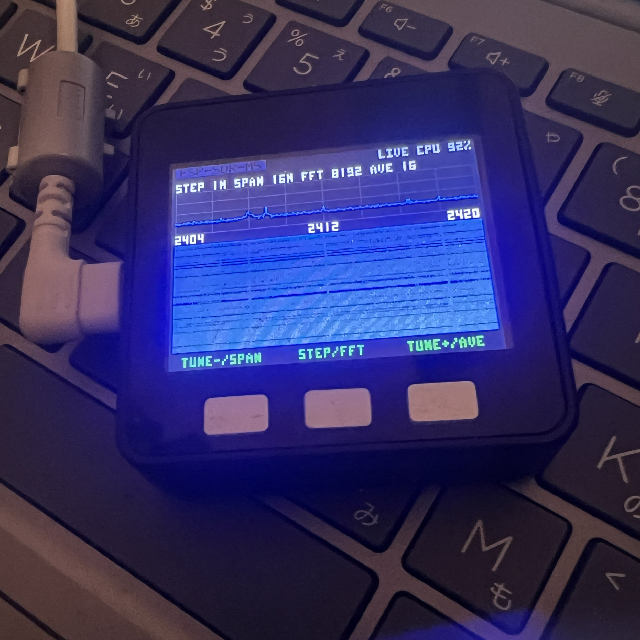
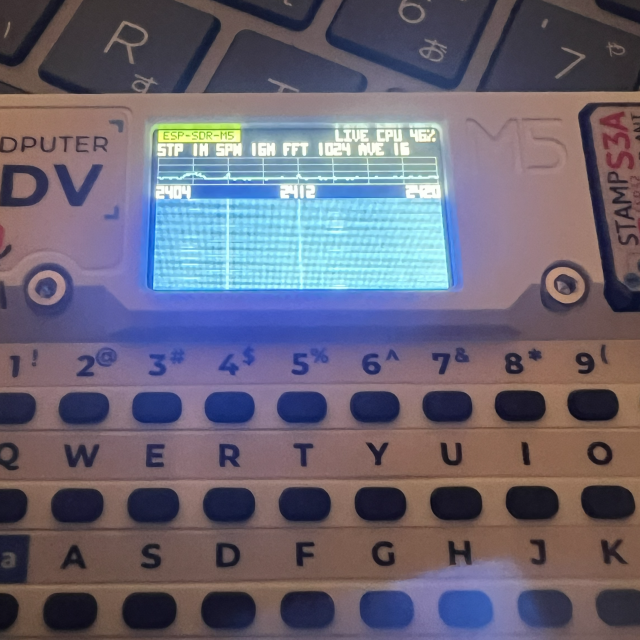
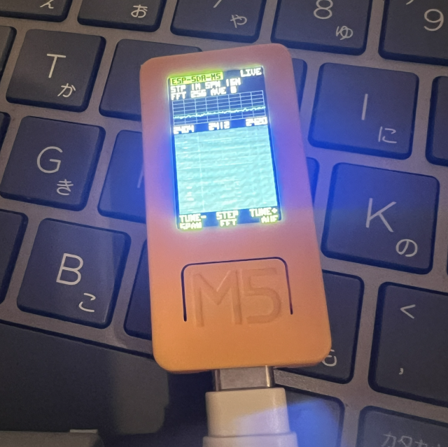

# ESP-SDR for M5Stack

English | [日本語](README.ja.md)

Turn an M5Stack device into a standalone spectrum and waterfall display using
its built-in ESP32 radio. No external SDR hardware or computer is needed during
standalone operation.

This project is a fork of [ESPARGOS/esp-sdr](https://github.com/ESPARGOS/esp-sdr),
adapted to run ESP-SDR directly on M5Stack devices with their own screens and
controls. The ESP32 captures I/Q samples, computes FFTs and draws the results
on the built-in display. A computer is needed to build and flash the firmware;
after that, the device can run on its own.

## Features

- Spectrum trace and scrolling color waterfall on the device's LCD.
- On-device frequency tuning, step, span, FFT size and averaging controls.
- Standalone profiles for M5Stack BASIC, Core2, Cardputer, Cardputer ADV and
  M5StickC Plus2.
- FFT sizes from 256 to 8192 points on BASIC, Core2 and M5StickC Plus2, or up to
  4096 points on Cardputer and Cardputer ADV.
- Optional PC connection through the existing ESP-SDR USB/UART protocol for
  I/Q capture and spectrum viewing.

## Devices and hardware test status

**M5Stack BASIC, Core2 and the original Cardputer (K132, non-ADV) have been
verified on real hardware in this project.** Cardputer ADV is also shown
running below. M5StickC Plus2 has also been verified on real hardware.

| Device | Chip | Display | Build profile | Hardware test status |
| --- | --- | --- | --- | --- |
| M5Stack BASIC | ESP32 | 320 × 240 | `m5stack-basic` | **Verified** |
| M5Stack Core2 | ESP32 | 320 × 240 | `m5stack-core2` | **Verified** |
| Cardputer, original K132 | ESP32-S3 | 240 × 135 | `m5stack-cardputer` | **Verified** |
| Cardputer ADV | ESP32-S3 | 240 × 135 | `m5stack-cardputer-adv` | **Verified** |
| M5StickC Plus2 | ESP32 | 135 × 240, portrait | `m5stickc-plus2` | **Verified** |

The M5StickC profile specifically targets **M5StickC Plus2**. It does not imply
compatibility with the original M5StickC or M5StickC Plus. Other devices and
chip profiles inherited from upstream have not been hardware-verified in this
fork.

## Operating photos

### M5Stack BASIC



### Cardputer ADV



### M5StickC Plus2



## Build environment

### 1. Clone this repository

Install Git and Python, then clone the repository with its ESP-DSP submodule.
These commands work in both sh and PowerShell:

```sh
git clone --recursive https://github.com/sake846/esp-sdr-m5.git
cd esp-sdr-m5
```

If you already cloned it without submodules, run:

```sh
git submodule update --init --recursive
```

### 2. Install and activate the pinned ESP-IDF

All five M5Stack profiles currently use ESP-IDF commit
`25fe69f946311abdaf9ad56591f25fedbc20ac98`. The required revision for each
profile is recorded in [firmware-targets.json](firmware-targets.json). Use that
revision when building these profiles.

Install the ESP-IDF host prerequisites for your OS first. On Windows, use
Python 3.12 and ensure Python and Git are on your PATH; see the
[Windows development setup](docs/windows-development-setup.md) for additional
setup notes.

Choose the commands for your shell below. Both install the pinned SDK beside
this repository and return to the repository root. Run them from the
`esp-sdr-m5` directory.

**sh (Linux/macOS, Bash or Zsh)**

```sh
cd ..
git clone https://github.com/espressif/esp-idf.git esp-idf-esp-sdr
cd esp-idf-esp-sdr
git checkout 25fe69f946311abdaf9ad56591f25fedbc20ac98
git submodule update --init --recursive
./install.sh esp32,esp32s3
. ./export.sh
cd ../esp-sdr-m5
```

**PowerShell (Windows)**

```powershell
Set-Location ..
git clone https://github.com/espressif/esp-idf.git esp-idf-esp-sdr
Set-Location esp-idf-esp-sdr
git checkout 25fe69f946311abdaf9ad56591f25fedbc20ac98
git submodule update --init --recursive
.\install.ps1 'esp32,esp32s3'
. .\export.ps1
Set-Location ..\esp-sdr-m5
```

In each new terminal session, activate this ESP-IDF environment before running
`idf.py`. From the repository root, use the command for your shell:

**sh**

```sh
. ../esp-idf-esp-sdr/export.sh
```

**PowerShell**

```powershell
. ..\esp-idf-esp-sdr\export.ps1
```

## Build and flash by device

Connect the device with a USB data cable, then run the commands for your model
and shell from the repository root in the activated ESP-IDF environment.
The sh examples use a backslash (`\`) for line continuation; PowerShell uses
a backtick (`` ` ``). Keep the continuation character at the end of its line,
with no trailing spaces.

Replace `PORT` with the device's serial port, for example `COM5` on Windows,
`/dev/ttyUSB0` or `/dev/ttyACM0` on Linux, or `/dev/cu.usbmodem...` on macOS.
Use a separate build directory for each profile, as shown below.

### M5Stack BASIC

**sh**

```sh
idf.py -B build-m5stack-basic -DIDF_TARGET=esp32 \
  -DSDKCONFIG=build-m5stack-basic/sdkconfig \
  -DSDKCONFIG_DEFAULTS=sdkconfig.defaults.m5stack-basic build
idf.py -B build-m5stack-basic -p COMx flash
```

**PowerShell**

```powershell
idf.py -B build-m5stack-basic -DIDF_TARGET=esp32 -DSDKCONFIG=build-m5stack-basic/sdkconfig '-DSDKCONFIG_DEFAULTS=sdkconfig.defaults.m5stack-basic' build
idf.py -B build-m5stack-basic -p COMx flash
```

The profile uses 4 MB of flash and also fits newer 16 MB BASIC devices.
The default LCD driver is ILI9342C. If an early BASIC has an ILI9341 LCD, run
`idf.py -B build-m5stack-basic menuconfig`, enable **ESP-SDR board > Early
Basic with ILI9341 LCD**, then rebuild and flash.

### M5Stack Core2

**sh**

```sh
idf.py -B build-m5stack-core2 -DIDF_TARGET=esp32 \
  -DSDKCONFIG=build-m5stack-core2/sdkconfig \
  -DSDKCONFIG_DEFAULTS=sdkconfig.defaults.m5stack-core2 build
idf.py -B build-m5stack-core2 -p COMx flash
```

**PowerShell**

```powershell
idf.py -B build-m5stack-core2 -DIDF_TARGET=esp32 -DSDKCONFIG=build-m5stack-core2/sdkconfig '-DSDKCONFIG_DEFAULTS=sdkconfig.defaults.m5stack-core2' build
idf.py -B build-m5stack-core2 -p COMx flash
```

This profile uses the Core2's LCD and three touch zones along the bottom of the
screen. It includes support for AXP192 and AXP2101 power controllers.

### Cardputer, original K132

**sh**

```sh
idf.py -B build-m5stack-cardputer -DIDF_TARGET=esp32s3 \
  -DSDKCONFIG=build-m5stack-cardputer/sdkconfig \
  -DSDKCONFIG_DEFAULTS=sdkconfig.defaults.m5stack-cardputer build
idf.py -B build-m5stack-cardputer -p COMx flash
```

**PowerShell**

```powershell
idf.py -B build-m5stack-cardputer -DIDF_TARGET=esp32s3 -DSDKCONFIG=build-m5stack-cardputer/sdkconfig '-DSDKCONFIG_DEFAULTS=sdkconfig.defaults.m5stack-cardputer' build
idf.py -B build-m5stack-cardputer -p COMx flash
```

Use this profile for the original, non-ADV Cardputer. It uses the built-in
keyboard matrix and native USB Serial/JTAG.

### Cardputer ADV

**sh**

```sh
idf.py -B build-m5stack-cardputer-adv -DIDF_TARGET=esp32s3 \
  -DSDKCONFIG=build-m5stack-cardputer-adv/sdkconfig \
  -DSDKCONFIG_DEFAULTS=sdkconfig.defaults.m5stack-cardputer-adv build
idf.py -B build-m5stack-cardputer-adv -p COMx flash
```

**PowerShell**

```powershell
idf.py -B build-m5stack-cardputer-adv -DIDF_TARGET=esp32s3 -DSDKCONFIG=build-m5stack-cardputer-adv/sdkconfig '-DSDKCONFIG_DEFAULTS=sdkconfig.defaults.m5stack-cardputer-adv' build
idf.py -B build-m5stack-cardputer-adv -p COMx flash
```

The ADV requires its own profile because its keyboard uses a TCA8418 I²C
controller. Do not substitute the original Cardputer profile.

### M5StickC Plus2

**sh**

```sh
idf.py -B build-m5stickc-plus2 -DIDF_TARGET=esp32 \
  -DSDKCONFIG=build-m5stickc-plus2/sdkconfig \
  -DSDKCONFIG_DEFAULTS=sdkconfig.defaults.m5stickc-plus2 build
idf.py -B build-m5stickc-plus2 -p COMx flash
```

**PowerShell**

```powershell
idf.py -B build-m5stickc-plus2 -DIDF_TARGET=esp32 -DSDKCONFIG=build-m5stickc-plus2/sdkconfig '-DSDKCONFIG_DEFAULTS=sdkconfig.defaults.m5stickc-plus2' build
idf.py -B build-m5stickc-plus2 -p COMx flash
```

This profile uses the portrait LCD and built-in A/B/C buttons.

After flashing, power on or reset the device to start the standalone display.
It starts at 2412 MHz with a 16 MHz span, a 256-point FFT and automatic gain
control.

## Standalone controls

### BASIC and Core2

Core2 uses three touch zones corresponding to A/B/C.

| Control | Short press | Hold for 0.6 seconds |
| --- | --- | --- |
| A | Tune down by the selected step | Cycle span |
| B | Cycle tuning step | Cycle FFT size |
| C | Tune up by the selected step | Cycle averaging count |

### M5StickC Plus2

| Button | Short press | Hold for 0.6 seconds |
| --- | --- | --- |
| C (left side) | Tune down by the selected step | Cycle span |
| A (center) | Cycle tuning step | Cycle FFT size |
| B (right side) | Tune up by the selected step | Cycle averaging count |

### Cardputer and Cardputer ADV

| Key | Action |
| --- | --- |
| `,` | Tune down by the selected step |
| `.` or `/` | Tune up by the selected step |
| `0`–`9` | Enter four digits to set the frequency in MHz, e.g. `2412` |
| `T` | Cycle tuning step |
| `P` | Cycle span |
| `F` | Cycle FFT size |
| `A` | Cycle averaging count |
| `Shift` + `T`, `P`, `F` or `A` | Cycle that setting in reverse |
| `Space` | Show or hide keyboard help |

Tuning steps are 1, 5, 20 and 100 MHz. Spans are 2, 4, 8, 16, 40 and 80 MHz;
the 2/4/8 MHz views zoom into a 16 MS/s capture. Averaging counts are 1, 2, 4,
8 and 16.

## Optional PC connection

Standalone operation does not need a PC. To use the serial protocol, connect
the device over USB and open the [ESP-SDR browser viewer](https://espargos.net/espsdr/app/)
or another compatible client. BASIC, Core2 and M5StickC Plus2 use their onboard
USB-UART bridge at **2,000,000 baud**; Cardputer models use native USB
Serial/JTAG.

PC commands take priority and pause local controls and captures. Standalone
operation resumes after `RELEASE` or five seconds without commands. See the
[protocol reference](docs/protocol.md) for details.

## Radio and display limitations

- These M5Stack profiles receive primarily around **2.4 GHz**. Experimental
  tuning can reach roughly 1.85 GHz, but the accepted 100–6000 MHz setting
  range does not mean reception works across that entire range. See
  [RX controls](docs/rx-controls.md).
- The standalone display uses snapshot captures with gaps between them.
- Spectrum and waterfall levels show relative power and are not calibrated
  in dBm.
- This is receive-only firmware for spectrum display and I/Q capture. It does
  not provide audio demodulation.

## Further documentation

- [M5Stack BASIC display and hardware notes](docs/m5stack-basic.md)
- [Core2, Cardputer and M5StickC Plus2 hardware notes](docs/m5stack-core2-cardputer.md)
- [Spectrum processing](docs/spectrum.md)
- [How ESP-SDR captures radio samples](docs/how-it-works.md)
- [Firmware profiles and pinned ESP-IDF revisions](firmware-targets.json)

## Upstream and credits

The radio capture mechanism and original ESP-SDR firmware come from
[ESPARGOS/esp-sdr](https://github.com/ESPARGOS/esp-sdr). This fork focuses on
standalone M5Stack displays and controls. For the original project's broader
chip support and research, see the [upstream repository](https://github.com/ESPARGOS/esp-sdr)
and [project overview](https://espargos.net/espsdr/).

Thanks to the upstream contributors, including
[Florian Euchner](https://github.com/Jeija),
[Zoltan Doczi](https://github.com/zodoczi) and [14sea](https://github.com/14sea),
and to [h0m3us3r](https://github.com/h0m3us3r/eSpDR) for the 5/6 LO investigation
that informed lower-frequency tuning.

## License

ESP-SDR is licensed under **GPL-3.0-or-later**; see [LICENSE](LICENSE).
If you distribute a modified version, you must make its source available under
the GPL.

Third-party code retains its own licenses, including the Apache-2.0 ESP-IDF
code in `platform/esp32s2/esp_usb_cdc_rom_console/`, the
[ESP-DSP component](components/esp-dsp/LICENSE), and the FFT kernels derived
from it in `main/targets/esp32s3/s3_fft_rnd.S` and
`main/targets/esp32s31/burst/s31_fft_rnd.S`.
